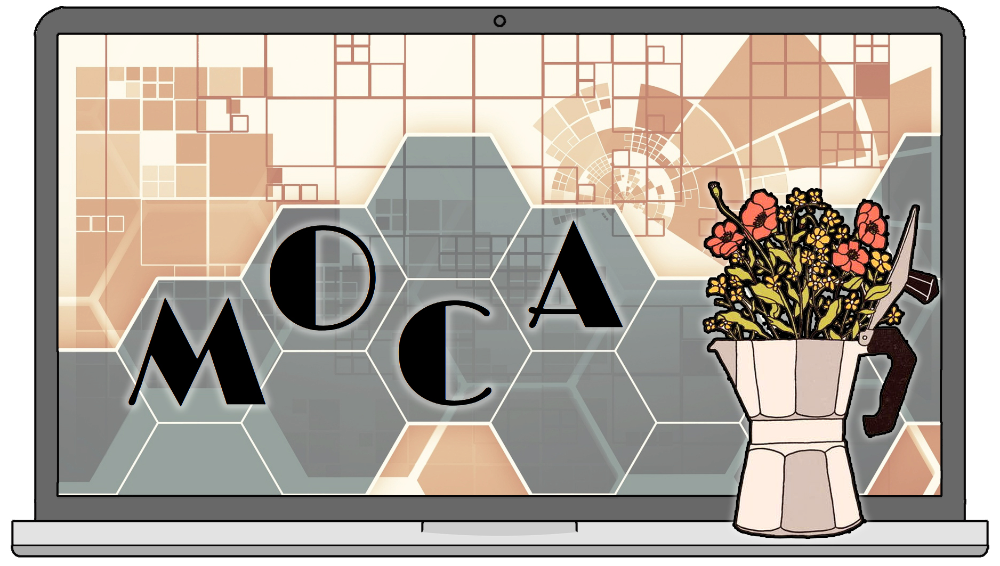
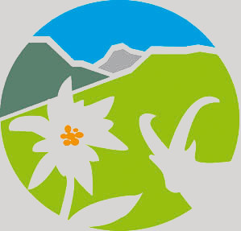

---
output:
  html_document:
    number_sections: no
    toc: no
---

<br/><br/>


```{css, echo=FALSE}
@import url('https://fonts.googleapis.com/css?family=Londrina+Solid:200,300|Medula+One');
header {
   font-family: 'Londrina Solid', cursive;
   font-weight: 300;
   font-size: 50px;
   line-height: 1.1;
   background-color: #d8d5d5;
   padding: 10px;
   margin-bottom: 50px;
   border-radius: 3px;
   color: #50555e;
}
h2, h3 {
   padding: 10px;
   border-radius: 3px;
   color: #50555e;
   font-family: 'Londrina Solid', cursive;
}
h2 {
   background-color: #e6c49f;
}
h3 {
   background-color: #d8d5d5;
}
footer {
   background-color: #d8d5d5;
   padding: 10px;
   border-radius: 3px;
   text-align: right;
   color: #50555e;
}
```

<header>
Newsletter MOCA - Octobre 2026 
<span style="float:right;">

&nbsp;

</span>
</header>

<div style="text-align:right;">*En [bleu](), liens cliquables !*</div>
<br/>


<div style="text-align:center;">
**Au soleil, le matin, les arbres sont en or ; <br/>
Octobre leur a fait des feuilles précieuses <br/>
Qui tremblent à la brise et, toujours anxieuses, <br/>
Craignent le vent d’automne en qui passe la mort.** <br/>
*Albert Lozeau*
</div>

<br/>

Si vous voulez contribuer au recensement de la Bibliothèque du LECA, [c'est ici :)](https://docs.google.com/spreadsheets/d/1f76E9yOZLzyLES1LTQqRttLVTeqHBoQJS16AE9eCHWQ/edit?usp=sharing)

</br></br>


## HAL

**Pensez à rentrer vos publications / livres / thèses / conférences / posters sur [HAL](https://hal.science/) !**

<br/>

1. Mettez à jour votre **profil**

- Configurez votre **IdHAL** (haha), en ajoutant votre identifiant ORCID, votre adresse mail, vos autres identifiants.
- Vous pourrez ensuite sélectionner votre **Forme** préférée sous laquelle apparaître (par exemple, *Maya Guéguen*, plutôt que *M Gueguen*).
- Ajoutez votre **affiliation** (Mon profil/Mes affiliations/) en tapant `LECA` <br/> et en vous assurant de bien choisir le Laboratoire d'Ecologie Alpine sur la période `2020 -> ...`.

2. Si vous rentrez un article en **open-access**, donnez le fichier via l'URL.
Sinon, exportez la **version acceptée mais non éditée** de l'article.

3. Remplir si possible les **affiliations pour tous les co-auteurs** !

- a minima pour les personnes du LECA
- vérifiez les assignations de tout le monde, certains sont parfois assignés à un ancien labo

4. Remplir les **rubriques thématiques**

5. Indiquez les **financements** en mettant le numéro du projet !

- soit directement dans les rubriques ANR, Projets Européens, etc
- soit dans les lignes Financement
- important à la fois pour les financeurs, et pour avoir une vision d'ensemble lors des exports

6. Ajoutez les liens vers les **dépots de données ou de code** dans la case `Voir aussi`.

</br></br>


## GRICAD - Bettik

Merci ! à toutes celles et ceux qui ont fait du **nettoyage** ou m'ont fait des **retours sur l'occupation de bettik**. <br/>
Pour rappel, sont disponibles à tous :

- le fichier de recensement de l'occupation par utilisateur sur `/bettik/0-USAGE/`
- de façon personnalisée dans `/bettik/0-USAGE/users/username.sizes.txt` (en remplaçant `username` par votre identifiant AGALAN) pour avoir un aperçu direct de vos dossiers les + surchargés

<br/> 

- Pour rappel, lorsque vous voulez **transférer des fichiers volumineux** (uploader ou télécharger), vous devez passer par **Cargo**. Vous vous connectez à Cargo comme vous vous connecteriez à un cluster (Dahu, Luke, etc), et vous arrivez par défaut dans votre *home* Dahu, mais **tous les espaces du cluster peuvent être accédés depuis ce point** ! Voici les chemins :
    - Dahu : `/home/monidAGALAN/`
    - Bigfoot : `/home-bigfoot/monidAGALAN/`
    - Luke : `/home-luke/monidAGALAN/`
    - Kraken : `/home-kraken-cpu/monidAGALAN/` ou `/home-kraken-gpu/monidAGALAN/`
    - Stockages / Scratch : `/bettik/`, `/silenus/` ou `/summer/`
    - Mantis : via commandes iRODS

- bettik n'est PAS un espace sauvegardé, donc si le disque dur contenant vos données crâme, c'est disparu pour toujours.
- **Mantis** est un espace de stockage **dont une partie** est sauvegardée, à condition de bien diriger ses données vers cette partie *backup*
- L'accès à Mantis se fait 
    - soit via [lignes de commandes iRODS](https://gricad-doc.univ-grenoble-alpes.fr/hpc/data_management/mantis/) à installer via un package NIX
    - soit via l'interface web [Metalnx](https://mantis.univ-grenoble-alpes.fr/metalnx/)
    
    
*N'hésitez pas si vous avez besoin d'aide pour effectuer ces transferts !*

</br></br>


## GRICAD - Feedbacks Septembre 2026

Merci ! à toutes celles et ceux qui ont bien voulu me faire leurs **retours sur l'utilisation du cluster**. <br/>
Ces retours ont été synthétisés [dans ce document](documents/CR_retours_GRICAD_LECA_260910.pdf), que j'ai fait remonter à l'OSUG en amont de leur réunion mensuelle avec GRICAD.

**Dans un souci de priorisation des demandes**, j'ai notamment insisté sur :

- le besoin d'une documentation friendly et fiable (à jour)
- la difficulté de faire tourner des jobs longs
    
même si l'ensemble des points ont été abordés, et souvent partagés avec les autres représentants d'unités.

<br/>

**Suite à la réunion OSUG - GRICAD qui a fait suite, les retours sont les suivants :**

> [OSUG] <br/>
- force et importance d’une approche mutualisée pour calcul et fonctionnalités d’usage <br/>
- MAIS perception de limites ou difficultés avec risques d’impact important (basculement d’usage non linéaire)

- *Comprendre :* l'approche mutualisée c'est bien, mais y a des blocages identifiés qui peuvent mener à la non-utilisation de GRICAD au profit de serveurs internes ou autres solutions, alors qu'un méso-centre comme GRICAD doit normalement servir de lien entre les labos et les centres de calcul nationaux / européens. 

> [GRICAD]  <br/>
- des limites sont connues ; beaucoup ont un fondement technique <br/>
(eg sécurité, choix faits à l’echelle globale incluant besoins autres utilisateurs) <br/>
- Améliorations doc, support : oui, contributions docs bienvenues ; <br/>
tickets mais peu de questions directes ; <br/>
en mm temps, regroupement de messages/questions à l’échelle OSUG bienvenus. <br/>
- + de ressources pour mieux coller ambition – pleine utilisation (personnes en fonction très effectives mais probablement souvent en pleine charge) <br/>
- intérêt de clarifier les capacités clé (calcul, fonctionnalités) et ce qu’on vise de bien couvrir par GRICAD, <br/>
pour ajuster/optimiser les ressources-support, <br/>
et pour communication vers usagers (orienter les utilisations, questions)
 
**Conclusions / pistes de travail :**

- Groupe de travail OSUG-GRICAD « cartographie » :
  - établir liste des besoins bien couverts / non couverts (pour raison de fond)
  - discussion sur zone intermédiaire (serait couvrable mais à condition de modifs ou renforcement support, ou ...)
  - évaluation d'*impact* pour OSUG (en termes qualitatifs, criticabilité ou quantitatif : nb d’usagers ou de jobs concernés)
  
**/!\\** Ce n'est PAS une co-construction du plan d’action / arbitrages, qui restent du ressort de GRICAD pour les ressources GRICAD et respectivement pour OSUG.

</br></br>


## Gérer vos données / codes

Plusieurs outils sont à votre disposition pour partager vos codes / données.

*Gérés par Maya :*

- L'[organisation `leca-dev` sur github](https://github.com/leca-dev) peut héberger vos projets de développement.
- Le [groupe `LECA` sur gricad-gitlab](https://gricad-gitlab.univ-grenoble-alpes.fr/leca) peut vous permettre la même chose de façon fermée. <br/>
Et plusieurs scripts sont partagés dans le sous-dossier `PASTIS/LSD/`
- Le [siteweb RLeca](http://rleca.pbworks.com/) se fait un peu vieux mais reste pratique pour partager des scripts ou des tutoriels.
- La [page PRODUCTION/Logiciels/ sur le site web du LECA](https://leca.osug.fr/-Logiciels-169-) peut accueillir vos descriptions de packages / softwares.

*Gérés par Julien :*

- Le [dataverse LECA usr data.InDoRES](https://data.indores.fr/dataverse/LECA) permet de partager vos données et codes (similaire à Zenodo par exemple).
- Le [catalogue cat.InDoRES](https://cat.indores.fr/geonetwork/srv/eng/catalog.search) recueille les métadonnées de tous vos dépots et ressources en ligne.

*Gérés pas par MOCA :*

- [HAL](https://hal.science/) permet de déposer des publications et leurs métadonnées, mais également plein d'autres supports, dont des logiciels.
- [Software Heritage](https://www.softwareheritage.org/) est une archive universelle de logiciels qui collecte toutes les ressources codes qu'elle trouve en ligne. Vous pouvez vérifier si votre code s'y trouve déjà, ou bien le soumettre sinon.

<br/><br/>
<br/><br/>


### Documentation - Archives


- [RLeca](http://rleca.pbworks.com/) :

      - scripts R
      - tutoriels ggplot2, biomod2...
      - documentation pour modèles mixtes, analyses multivariées, SIG...
      - tutoriels UNIX, OBITOOLS, CIMENT, LaTeX

- [LECA github](https://github.com/leca-dev)
- [LECA gitlab](https://gricad-gitlab.univ-grenoble-alpes.fr/leca/) (identifiants AGALAN)
- [LSD](https://gricad-gitlab.univ-grenoble-alpes.fr/leca/pastis/lsd) : LECA Script Directory (identifiants AGALAN)

      - script R, python... pour extraction et analyse de données, traitement de séquences ADN, etc
      - liens vers de la documentation en ligne (R, SIG, best coding practices...)
      - tutoriels

- [OBITools3](https://git.metabarcoding.org/obitools/obitools3) : package for the management of analyses and data in DNA metabarcoding

- [LECA Androsace](http://originalps.osug.fr) : BDD traits fonctionnels des plantes alpines
- [LECA ORCHAMP](https://orchamp.osug.fr/) : Observatoire spatio-temporel de la biodiversité et du fonctionnement des socio-écosystèmes de montagne

- [LECA data.InDoRES dataverse](https://data.indores.fr/dataverse/LECA)
- [cat.InDoRES geocatalog](https://cat.indores.fr/geonetwork/srv/eng/catalog.search)


<br/>

#### [Archives newsletters](https://leca-dev.github.io/newsletters/)

<br/><br/>

<footer>*Rédigé par Maya Guéguen, le 5 juin 2026*</footer>

<br/><br/>
